# 01 — Architecture détaillée du moteur Meeting & Transcript Processing

## 1. Objet du document

Ce document formalise la conception cible de la brique 01 à partir du dépôt observé. Il distingue le code frontend existant, la logique partielle, les composants à développer et les validations externes. Le backend/persistance ci-dessous sont une cible, non des fonctionnalités déjà opérationnelles.

- OBSERVÉ CÔTÉ CLIENT ;
- PARTIEL ;
- À DÉVELOPPER ;
- À CONFIRMER ;
- DÉPENDANT D'UNE VALIDATION DGF OU MICROSOFT 365.

## 2. Constat de base sur le dépôt

### 2.1. Éléments réellement observés

Le dépôt contient un socle front-end bien structuré, centré sur l'authentification Microsoft et la récupération de transcriptions.

Composants majeurs observés :

- [src/services/graphClient.ts](../../../src/services/graphClient.ts) : client Microsoft Graph, acquisition de jeton, diagnostics, récupération de réunions
- [src/services/transcriptService.ts](../../../src/services/transcriptService.ts) : résolution d'une réunion, recherche/lecture des transcriptions, parsing VTT, parsing non attribué, validation humaine
- [src/config/msalConfig.ts](../../../src/config/msalConfig.ts) : validation de redirect URI et configuration MSAL
- [src/types/transcript.ts](../../../src/types/transcript.ts) : types métier du pipeline de transcription
- [src/types/meeting.ts](../../../src/types/meeting.ts) : metadonnées de réunion, rôles, statuts d'accessibilité
- [backend/src/ReadMeeting.Application/Interfaces/IMicrosoftGraphService.cs](../../../backend/src/ReadMeeting.Application/Interfaces/IMicrosoftGraphService.cs) : contrat backend Graph
- [backend/src/ReadMeeting.Domain/Entities/Meeting.cs](../../../backend/src/ReadMeeting.Domain/Entities/Meeting.cs) : modèle de domaine de réunion
- [backend/src/ReadMeeting.Domain/Entities/MeetingReport.cs](../../../backend/src/ReadMeeting.Domain/Entities/MeetingReport.cs) : modèle de compte rendu

### 2.2. Ce qui est observé dans le code (sans extrapolation)

- récupération du calendrier Outlook via Graph ;
- détection des réunions Teams ;
- résolution d'une réunion via `JoinWebUrl` ;
- recherche de transcriptions ;
- récupération du contenu VTT ;
- gestion des erreurs Graph et Entra ID ;
- fallback vers `application/vnd.microsoft.graph.transcript+text` si `SpeakerAttributionNotAllowed` ;
- parsing des segments horaires, y compris sans attribution ;
- garde-fou logique `enforceHumanValidationGate` fondé sur les champs d'approbation fournis en entrée (ce n'est ni un workflow humain persistant ni un validateur structurel complet) ;
- tests automatiques de logique transcript côté TypeScript.

### 2.3. Ce qui reste hors du code réel

- backend ASP.NET Core exécutable et complet ;
- persistance PostgreSQL fonctionnelle ;
- repository de transcriptions et de segments ;
- moteur IA structureur ;
- génération DOCX/PDF ;
- publication SharePoint ;
- participation Teams en direct ;
- pipeline complet de mise à disposition pour un moteur IA.

La validation terrain de la récupération de transcriptions dans les scénarios A et B est rapportée par le responsable du projet dans le référentiel global. Elle est distincte des tests automatisés avec Graph mocké ; cette revue n'a pas exécuté de nouvel appel authentifié.

## 3. Vue d'ensemble de la brique cible

La brique 01 est un service transactionnel et traçable situé entre :

- Microsoft Graph (source de vérité) ;
- le contexte utilisateur DGF ;
- la persistance technique.

Une interface d'extension vers l'extraction IA pourra être ajoutée dans un lot distinct ; l'IA ne fait pas partie des dépendances ni des critères d'acceptation de cette brique.

## 4. Décomposition fonctionnelle cible

### 4.1. Meeting Connector

Statut : OBSERVÉ CÔTÉ CLIENT ; à intégrer au backend cible

Responsabilité :
- interroger le calendrier de l'utilisateur ou de l'organisateur ;
- filtrer les réunions pertinentes pour la DGF ;
- identifier les réunions Microsoft Teams.

Entrées :
- compte MSAL actif ;
- plage temporelle ;
- profil utilisateur.

Sorties :
- liste de réunions structurées ;
- informations de contexte (organisateur, URL de réunion, date, statut).

Dépendances :
- client Graph ;
- types `MeetingItem` ;
- classification de l'organisateur.

### 4.2. Meeting Resolver

Statut : CODE OBSERVÉ CÔTÉ CLIENT

Responsabilité :
- résoudre une réunion Teams à partir du `JoinWebUrl` ;
- identifier sa référence `onlineMeetingId` dans Graph.

Implémentation actuelle observée :
- `resolveOnlineMeetingId` est présent dans [src/services/transcriptService.ts](../../../src/services/transcriptService.ts)

### 4.3. Transcript Discovery

Statut : CODE OBSERVÉ CÔTÉ CLIENT

Responsabilité :
- appeler `/me/onlineMeetings/{id}/transcripts` ou la variante utilisateur/organisateur ;
- analyser l'ensemble des transcriptions disponibles ;
- distinguer absence, refus d'accès, restrictions de partage et réponses vides.

### 4.4. Transcript Retrieval

Statut : CODE OBSERVÉ CÔTÉ CLIENT

Responsabilité :
- télécharger le contenu d'une transcription ;
- respecter les formats Graph supportés ;
- appeler le fallback lorsque le tenant refuse l'attribution speaker.

Implémentation actuelle observée :
- `fetchTranscriptContent` dans [src/services/transcriptService.ts](../../../src/services/transcriptService.ts)

### 4.5. Transcript Parser

Statut : PARSING OBSERVÉ CÔTÉ CLIENT

Responsabilité :
- parser un contenu VTT ;
- parser un contenu texte chronologique sans attribution ;
- préserver l'ordre chronologique et les timestamps.

Implémentation actuelle observée :
- `parseVttTranscript`
- `parseUnattributedTranscript`
- `NON_ATTRIBUTED_SPEAKER_LABEL`

### 4.6. Transcript Normalizer

Statut : PARTIEL (le parseur produit des cues normalisées ; composant d'orchestration/règles dédiées à formaliser)

Responsabilité cible :
- harmoniser les segments ;
- dédupliquer les doublons ;
- rendre explicite l'intervenant inconnu ;
- garder les données brutes séparées des données normalisées.

### 4.7. Transcript Structural Validator

Statut : À DÉVELOPPER (la détection des erreurs et le parsing existent côté client)

Responsabilité cible :
- vérifier les invariants de structure des segments (format, bornes temporelles, ordre, contenu exploitable) ;
- refuser la persistance d'un résultat structurellement invalide ;
- produire un résultat de validation déterministe et versionné.

Éléments réutilisables observés : `parseVttTranscript`, `parseUnattributedTranscript` et `explainTranscriptError` dans `src/services/transcriptService.ts`. Ils ne constituent pas à eux seuls le validateur décrit ci-dessus.

La validation humaine métier est hors périmètre de la brique 01. `enforceHumanValidationGate` est uniquement un garde-fou logique existant pour un futur flux documentaire.

### 4.8. Processing Orchestrator

Statut : À DÉVELOPPER

Responsabilité cible :
- coordonner le workflow complet ;
- gérer les statuts ;
- sécuriser les transitions ;
- gérer les retentatives ;
- offrir un point unique de contrôle.

### 4.9. Transcript Repository

Statut : À DÉVELOPPER

Responsabilité :
- persister le transcript brut ;
- persister les segments structurés ;
- stocker les métadonnées de provenance et d'exécution.

### 4.10. Processing Status & Traceability

Statut : PARTIEL CÔTÉ CLIENT ; persistance et suivi backend À DÉVELOPPER

Responsabilité :
- conserver l'historique de traitement ;
- enregistrer les erreurs et les retentatives ;
- fournir l'état de progression.

## 5. Architecture logique cible

```mermaid
flowchart LR
    U[Utilisateur DGF] --> FE[Frontend React/Vite]
    FE --> MSAL[MSAL / Entra ID]
    FE -->|JWT audience API| API[API de traitement cible]
    API -->|validation JWT + tenant + autorisation ressource| AUTH[Security boundary]
    AUTH -->|OBO cible ; token Graph serveur uniquement| GRAPH[Microsoft Graph]
    API --> MCONNECT[Meeting Connector backend à développer]
    GRAPH --> MCONNECT
    MCONNECT --> MRES[Meeting Resolver]
    MRES --> TDISC[Transcript Discovery]
    TDISC --> TRETR[Transcript Retrieval]
    TRETR --> TPARS[Transcript Parser]
    TPARS --> TNORM[Transcript Normalizer]
    TNORM --> TVAL[Structural Validator à développer]
    TVAL --> ORCH[Processing Orchestrator à développer]
    ORCH --> REPO[Transcript Repository à développer]
    REPO --> TRACE[Persistent run status & traceability]
    FE -->|POST run / GET status / GET transcript localId| API
    API -->|202 + runId ou résultat consultable| FE
```

## 6. Rôle des composants vis-à-vis du dépôt

### 6.1. Composants réutilisables

- `fetchRealCalendarMeetings` et `createGraphClient` : base de la couche Graph
- `resolveOnlineMeetingId` : base de résolution
- `fetchMeetingTranscripts` et `fetchTranscriptContent` : base de récupération
- `parseVttTranscript` / `parseUnattributedTranscript` : base de parsing
- `explainTranscriptError` : base de diagnostics et d'erreurs Graph
- `enforceHumanValidationGate` : garde-fou booléen d'approbation reçu en entrée uniquement ; hors workflow brique 01

### 6.2. Composants à adapter

- types de statut et de pipeline doivent être alignés avec un vrai modèle de base de données ;
- les diagnostics doivent sortir du contexte UI vers un service backend avec historique persistant ;
- le pipeline de traitement doit être orchestré côté API, pas seulement dans le client.

### 6.3. Composants à créer

- repository de transcript et de segments ;
- service de persistance et d'idempotence ;
- orchestration backend ;
- couche d'intégration Graph côté API/backend ;
- couche de sécurité et validation JWT OBO ;
- infrastructure de stockage brut et structuré.

## 7. Décision d'architecture

La conception recommandée n'est ni une refonte de l'existant, ni un “frontend only”. Elle consiste à conserver le socle Graph existant et à le faire évoluer vers une architecture à 3 couches :

1. Interface utilisateur / contexte Microsoft
2. API de traitement backend
3. Persistance et traçabilité

Cette décision est motivée par le fait que la récupération Graph et le parsing sont déjà présents, alors que la couche backend et la persistance sont absentes. L'architecture cible doit donc tirer parti du code existant sans le surcharger d'un modèle non encore validé.

## 8. Risques et limites

- le code actuel est fortement frontend-centric ;
- la logique de Graph n'est pas séparée dans un service backend exposable ;
- la persistance de transcript n'est pas réellement présente ;
- la coexistence VTT / non attribué exige un modèle de données explicite ;
- le workflow suivant les erreurs Graph dépend fortement de la configuration tenant, sans validation d'administration.

## 9. Conclusion

La brique 01 couvre uniquement la récupération des réunions, résolution Teams, découverte et récupération des transcriptions Graph, fallback, parsing, normalisation, validation structurelle, persistance, suivi des traitements et consultation structurée. L'extraction IA, les comptes rendus, la génération documentaire, SharePoint et la participation live Teams sont des lots distincts ; aucune de ces capacités n'est une dépendance déjà disponible.

L'architecture backend et l'OBO sont des cibles à concevoir et valider, pas des composants opérationnels du dépôt.

## 10. État de validation

- OBSERVÉ CÔTÉ CLIENT : récupération/résolution Graph, fallback, parsing et diagnostics TypeScript ; tests automatisés mockés présents
- EXISTANT PARTIEL : types/événements de diagnostic ; garde-fou logique d'approbation sans workflow persistant
- À DÉVELOPPER : API backend exécutable, validation JWT, OBO, orchestration, validateur structurel, repository, persistance et contrôles d'accès aux ressources
- À CONFIRMER : autorisations demandées, cible PostgreSQL, flux OBO, gestion réelle de l'API backend
- DÉPENDANT D'UNE VALIDATION DGF / M365 : permissions SharePoint, Graph avancé, éventuel agent Teams
