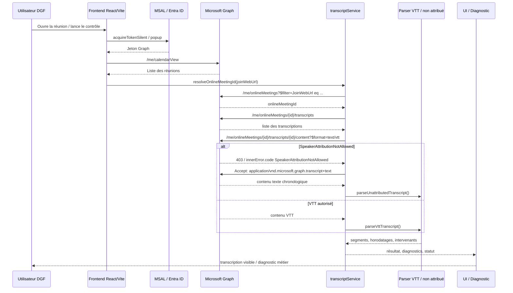
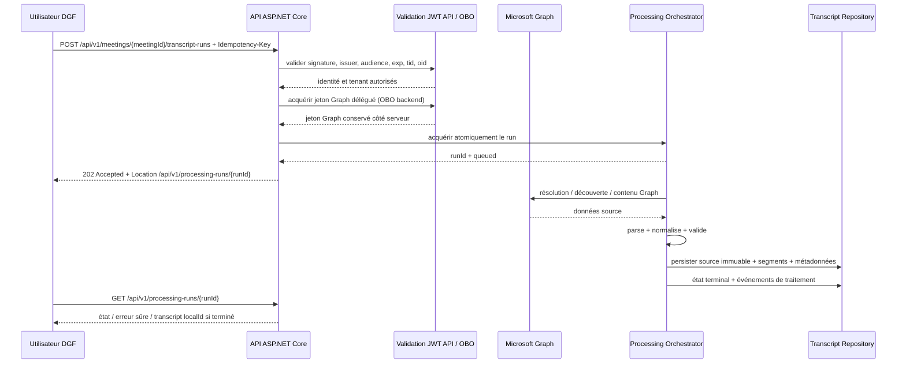
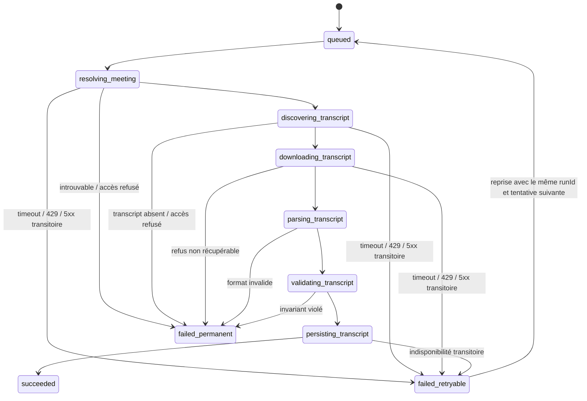
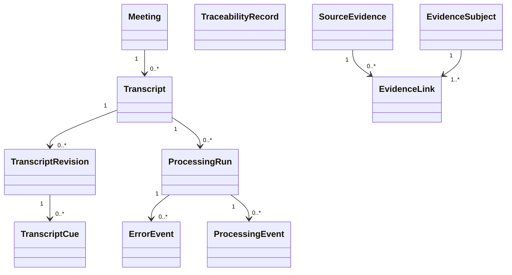

# 02 — Diagrammes de séquences du moteur Meeting & Transcript Processing

## 1. Objectif

Ce document décrit les flux de traitement à partir du dépôt réel. Il vise à illustrer les flux :

- de l'authentification au traitement de transcription ;
- de la résolution d'une réunion jusqu'à la mise à disposition structurée ;
- des exceptions Graph et des retours de fallback.

Les diagrammes ci-dessous reflètent la réalité du dépôt et la cible de conception. Les éléments non validés sont explicitement signalés.

## 2. Diagramme de flux existant côté navigateur (code observé)



## 3. Diagramme cible backend orienté API (asynchrone, non implémenté)



## 4. Diagramme d'erreur et de reprise



## 5. Diagramme de fallback attribution refusée

```mermaid
sequenceDiagram
    participant GRAPH as Microsoft Graph
    participant FE as transcriptService côté frontend actuel
    participant PARSER as Parser
    participant DIAG as Diagnostics

    FE->>GRAPH: GET /content?$format=text/vtt
    GRAPH-->>FE: 403 + innerError.code = SpeakerAttributionNotAllowed
    FE->>DIAG: notifier le déclenchement du fallback
    FE->>GRAPH: GET même endpoint et même graphTranscriptId + Accept: application/vnd.microsoft.graph.transcript+text
    GRAPH-->>FE: contenu horodaté sans attribution (HTTP constaté dans l'événement)
    FE->>PARSER: parseUnattributedTranscript
    PARSER-->>FE: segments et timestamps sans invention de nom
    FE-->>DIAG: parse success/failure + format + code/HTTP ; aucun texte intégral loggé
```

## 6. Diagramme de persistance candidate



## 7. Contraintes à respecter

- les routes cibles sont uniquement celles de [06_CONTRATS_API.md](./06_CONTRATS_API.md) ; aucun endpoint backend n'est attesté comme livré ;
- le flux OBO est une cible, pas un mécanisme existant dans le dépôt actuel ;
- le POST asynchrone renvoie `202` avec l'identifiant local du run et une URL de suivi ; il ne signifie pas que le traitement est terminé ;
- le jeton Graph acquis par OBO ne sort jamais du backend ;
- les erreurs Graph doivent être journalisées différemment selon les cas : permission, tenant, débit, parsing, persistance ;
- l'idempotence, le verrouillage atomique et le statut des runs suivent le contrat normatif des documents 04, 06 et 07 ;
- la persistance du contenu brut et du contenu normalisé doit rester séparée ;
- le périmètre s'arrête à la consultation structurée : aucune sortie IA ou génération documentaire n'est impliquée.

## 8. Statut par composant

- EXISTANT CÔTÉ CLIENT : Graph resolution/retrieval, parsing, fallback, diagnostics ; scénarios de tests mockés
- PARTIEL : garde-fou logique d'approbation humaine, sans workflow documentaire persistant
- À DÉVELOPPER : API backend, repository, persistance, orchestration centrale, validation structurelle, OBO
- À CONFIRMER : moteur de persistance, séparation raw/normalized, stratégie de stockage fichiers
- VALIDATION DGF / M365 : permissions Graph avancées, éventuel Participation Teams

## 9. Points d'attention

- les diagrammes de séquence doivent refléter le fait que le client front ne doit pas être la seule zone de logique métier ;
- la validation terrain des scénarios de transcription rapportée par le responsable est distincte des tests mockés et n'est pas reproduite par ce diagramme ;
- le fallback d'attribution ne remplace ni la qualification des droits effectifs du tenant ni la validation structurelle ;
- la persistance doit conserver la preuve d'origine, pas seulement le transcript normalisé.
