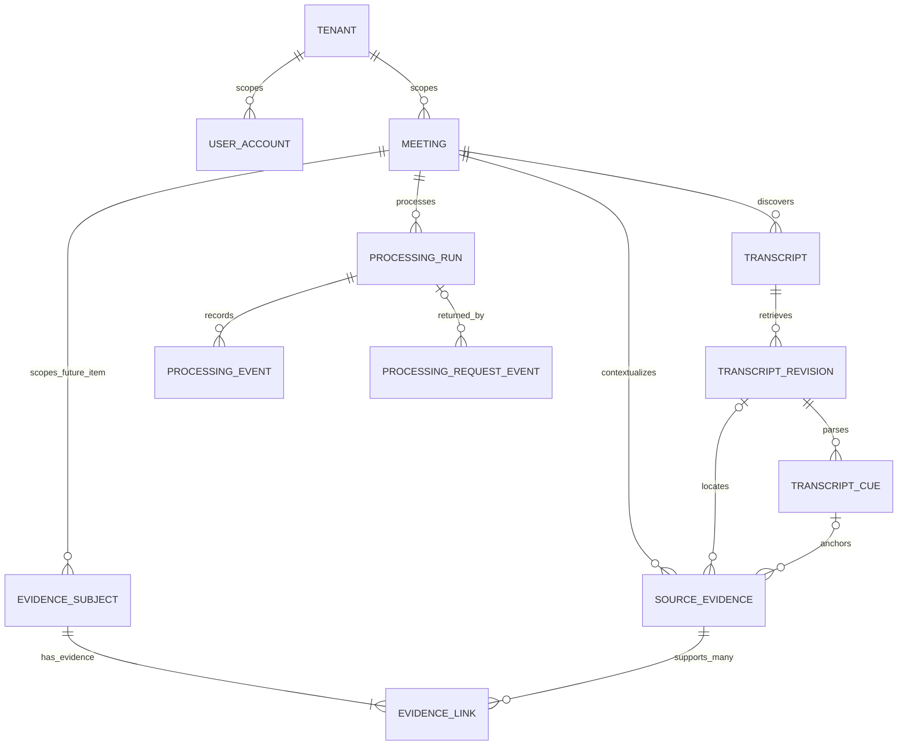

# 04 — Modèle de données du moteur Meeting & Transcript Processing

## 1. Objet et statut

Ce modèle logique est une cible à valider avant toute migration. Il décrit le socle de la brique 01 : réunions, sources de transcription, segments, traitements, événements et preuves de provenance. Il ne rend pas les entités d'extraction IA, de compte rendu, de SharePoint ou de participation Teams live nécessaires à cette brique.

Aucun schéma SQL ni aucune migration ne sont créés ici. PostgreSQL est une option proposée, non un choix d'infrastructure validé.

## 2. Identifiants et conventions

- `TenantId`, `UserId`, `MeetingId`, `TranscriptId`, `TranscriptRevisionId`, `CueId`, `ProcessingRunId`, `ProcessingEventId`, `EvidenceId` sont des UUID locaux, générés par l'application.
- `graphMeetingId`, `graphTranscriptId`, `m365ObjectId` sont des identifiants externes opaques, non substituables aux UUID locaux.
- Toutes les données persistées d'exploitation portent `tenant_id` ou sont atteignables par une FK composite vers une ligne qui le porte.
- Les instants sont stockés en UTC avec offset explicite (`timestamptz` si PostgreSQL est retenu) ; la durée de segment est aussi représentée en millisecondes numériques pour validation et recherche.
- Le contenu source est immuable par révision. Une nouvelle récupération ou une correction produit une nouvelle révision, jamais une écriture destructive du contenu antérieur.

## 3. Entités du périmètre brique 01

### 3.1 Tenant

**Rôle :** frontière de sécurité locale correspondant au tenant Microsoft Entra autorisé.

**Attributs :** `tenant_id UUID PK`, `entra_tenant_id VARCHAR NOT NULL`, `display_name VARCHAR`, `status ENUM(active,suspended)`, `created_at`, `updated_at`.

**Contraintes/relations :** `UNIQUE(entra_tenant_id)` ; référence parent pour toutes les entités tenant-scoped. Le mapping entre claim `tid` vérifié et `tenant_id` est résolu exclusivement côté serveur.

**Index :** unique `entra_tenant_id`, `status`.

### 3.2 UserAccount

**Rôle :** identifie un acteur authentifié dans un tenant.

**Attributs :** `tenant_id UUID`, `user_id UUID`, `entra_object_id VARCHAR`, `upn VARCHAR nullable`, `display_name VARCHAR nullable`, `is_active BOOLEAN`, `created_at`, `updated_at`.

**PK :** `(tenant_id, user_id)` ; **FK :** `(tenant_id) -> Tenant`. **Unique :** `(tenant_id, entra_object_id)`.

**Règle :** `entra_object_id` vient du claim `oid` après validation du token, pas du corps de requête.

### 3.3 Meeting

**Rôle :** référence locale d'une réunion découverte ou résolue.

**Attributs :** `tenant_id UUID`, `meeting_id UUID`, `graph_meeting_id VARCHAR nullable`, `join_web_url VARCHAR nullable`, `title VARCHAR nullable`, `organizer_m365_object_id VARCHAR nullable`, `start_at TIMESTAMPTZ nullable`, `end_at TIMESTAMPTZ nullable`, `status ENUM(discovered,resolved,not_teams,not_found)`, `created_at`, `updated_at`.

**PK :** `(tenant_id, meeting_id)` ; **FK :** tenant. **Unique conditionnelle :** `(tenant_id, graph_meeting_id)` quand la référence Graph existe.

**Relations :** 1 Meeting → 0..N Transcript ; 1 Meeting → 0..N ProcessingRun ; 1 Meeting → 0..N SourceEvidence.

### 3.4 Transcript

**Rôle :** identité locale stable de la transcription Graph sous une réunion.

**Attributs :** `tenant_id UUID`, `transcript_id UUID`, `meeting_id UUID`, `graph_transcript_id VARCHAR`, `discovered_at TIMESTAMPTZ`, `created_at`.

**PK :** `(tenant_id, transcript_id)` ; **FK composite** `(tenant_id, meeting_id) -> Meeting`. **Unique :** `(tenant_id, transcript_id, meeting_id)` et `(tenant_id, meeting_id, graph_transcript_id)`.

`graph_transcript_id` est l'identifiant Graph exact reçu à la découverte ; une même réunion peut avoir plusieurs transcripts. La suppression physique d'un transcript est soumise à la politique de rétention.

### 3.5 TranscriptRevision

**Rôle :** conservation immuable de chaque contenu récupéré et de ses métadonnées de provenance.

**Attributs :** `tenant_id UUID`, `transcript_revision_id UUID`, `transcript_id UUID`, `meeting_id UUID`, `revision_number INTEGER`, `source_format ENUM(vtt,graph_transcript_text,unknown)`, `retrieval_mode ENUM(vtt_primary,unattributed_fallback,manual_import)`, `raw_content_ref VARCHAR`, `raw_sha256 CHAR(64)`, `content_type VARCHAR nullable`, `retrieved_at TIMESTAMPTZ`, `graph_request_id VARCHAR nullable`, `created_at`.

**PK :** `(tenant_id, transcript_revision_id)` ; **FK composite** `(tenant_id, transcript_id, meeting_id) -> Transcript` ; **UNIQUE** `(tenant_id, transcript_revision_id, meeting_id)` et `(tenant_id, transcript_id, revision_number)`.

`raw_content_ref` pointe vers un stockage chiffré contrôlé ; la base peut contenir le brut uniquement si la politique le permet. La référence et le hash sont conservés sans copier le contenu dans les logs.

### 3.6 TranscriptCue

**Rôle :** segment normalisé dérivé d'une seule révision de source.

**Attributs :** `tenant_id UUID`, `cue_id UUID`, `transcript_revision_id UUID`, `sequence_number INTEGER`, `start_ms BIGINT`, `end_ms BIGINT nullable`, `speaker_name VARCHAR nullable`, `speaker_attribution ENUM(identified,unattributed,unknown)`, `text TEXT`, `normalized_text TEXT nullable`, `created_at`.

**PK :** `(tenant_id, cue_id)` ; **FK composite** `(tenant_id, transcript_revision_id) -> TranscriptRevision` ; **UNIQUE** `(tenant_id, cue_id, transcript_revision_id)` et `(tenant_id, transcript_revision_id, sequence_number)`.

**Contraintes :** `start_ms >= 0`, `end_ms IS NULL OR end_ms >= start_ms`, texte non vide après validation. Si attribution absente/refusée, `speaker_name IS NULL` et attribution `unattributed` ou `unknown`; aucun nom ne peut être inventé. La source brute immuable conserve son ordre d'origine ; les cues normalisées sont séquencées par horodatage croissant, avec stabilité de l'ordre source pour des horodatages égaux. Le validateur ne modifie pas les timestamps.

### 3.7 ProcessingRun

**Rôle :** une demande logique de traitement d'une réunion/transcription.

**Attributs :** `tenant_id UUID`, `processing_run_id UUID`, `meeting_id UUID`, `transcript_id UUID nullable`, `requested_by_user_id UUID`, `idempotency_key VARCHAR`, `request_payload_hash CHAR(64)`, `source_content_hash CHAR(64) nullable`, `parser_version VARCHAR`, `status ENUM(queued,resolving_meeting,discovering_transcript,downloading_transcript,parsing_transcript,validating_transcript,persisting_transcript,failed_retryable,succeeded,failed_permanent)`, `active_lock_token UUID nullable`, `attempt_count INTEGER`, `started_at TIMESTAMPTZ nullable`, `completed_at TIMESTAMPTZ nullable`, `created_at`, `updated_at`.

**PK :** `(tenant_id, processing_run_id)` ; **FK composites** `(tenant_id, meeting_id) -> Meeting`, `(tenant_id, transcript_id, meeting_id) -> Transcript` nullable, `(tenant_id, requested_by_user_id) -> UserAccount`. **Unique :** `(tenant_id, requested_by_user_id, idempotency_key)`.

Les états terminaux (`succeeded`, `failed_permanent`) sont immuables. Un traitement volontairement nouveau reçoit un nouveau `idempotency_key` et un nouveau `ProcessingRunId`.

### 3.8 ProcessingEvent

**Rôle :** historique append-only des étapes, tentatives et erreurs.

**Attributs :** `tenant_id UUID`, `processing_event_id UUID`, `processing_run_id UUID`, `attempt_number INTEGER`, `stage VARCHAR`, `from_status VARCHAR nullable`, `to_status VARCHAR`, `error_code VARCHAR nullable`, `graph_error_code VARCHAR nullable`, `inner_error_code VARCHAR nullable`, `http_status INTEGER nullable`, `graph_request_id VARCHAR nullable`, `retry_after_seconds INTEGER nullable`, `redacted_message VARCHAR nullable`, `occurred_at TIMESTAMPTZ`.

**PK :** `(tenant_id, processing_event_id)` ; **FK composite** `(tenant_id, processing_run_id) -> ProcessingRun`.

Ne pas stocker jeton, contenu intégral, ni paramètres URL contenant des données sensibles. Les événements ne sont pas modifiés ; la lecture du run calcule son état courant selon les transitions autorisées.

### 3.9 ProcessingRequestEvent

**Rôle :** trace append-only de chaque appel de démarrage, y compris les demandes qui réutilisent un run actif/réussi ou sont rejetées pour conflit. Un appel répété avec la même clé est une nouvelle occurrence HTTP et n'est pas confondu avec le run.

**Attributs :** `tenant_id UUID`, `request_event_id UUID`, `actor_user_id UUID`, `idempotency_key VARCHAR`, `request_payload_hash CHAR(64)`, `processing_run_id UUID nullable`, `outcome ENUM(created,reused_active,reused_result,forced_reprocess,rejected_conflict,rejected_invalid)`, `correlation_id VARCHAR`, `occurred_at TIMESTAMPTZ`.

**PK :** `(tenant_id, request_event_id)` ; **FK composite** `(tenant_id, actor_user_id) -> UserAccount`; FK composite facultative `(tenant_id, processing_run_id) -> ProcessingRun`.

Chaque nouvelle requête HTTP ajoute un événement, même si le serveur restitue le même run. Une même clé avec payload différent est journalisée comme conflit sans divulguer ni lier un run hors périmètre. Les événements sont append-only ; aucune donnée de contenu ou secret n'y figure.

## 4. Provenance et association plusieurs-à-plusieurs

Le moteur doit garder la capacité de lier une preuve à plusieurs éléments métiers futurs, et plusieurs preuves à un même élément, sans rendre l'extraction IA nécessaire à la première livraison.

### 4.1 SourceEvidence

**Rôle :** référence vérifiable à une source, sans dupliquer l'autorité de la transcription.

**Attributs :** `tenant_id UUID`, `evidence_id UUID`, `meeting_id UUID`, `transcript_revision_id UUID nullable`, `cue_id UUID nullable`, `source_kind ENUM(transcript_cue,meeting_metadata,manual_reference)`, `source_locator VARCHAR NOT NULL`, `excerpt_hash CHAR(64) nullable`, `start_ms BIGINT nullable`, `end_ms BIGINT nullable`, `created_at`.

**PK :** `(tenant_id, evidence_id)` ; **UNIQUE** `(tenant_id, evidence_id, meeting_id)` ; **FK composite** `(tenant_id, meeting_id) -> Meeting`; FKs composites facultatives `(tenant_id, transcript_revision_id, meeting_id) -> TranscriptRevision` et `(tenant_id, cue_id, transcript_revision_id) -> TranscriptCue`.

**Règles :**
- preuve transcript : `transcript_revision_id` et `cue_id` obligatoires, leurs relations doivent appartenir au même tenant et à la même réunion ; horodatage dérivé du cue ou d'un intervalle validé ;
- preuve de métadonnée : `source_locator` identifie le champ/source de réunion, aucun timestamp transcript fictif ;
- `excerpt_hash` sert à vérifier un extrait présenté par l'application ; aucun extrait sensible n'est écrit dans les logs.
- Les règles CHECK de type de preuve imposent soit une référence TranscriptRevision + Cue, soit une source de métadonnée identifiable ; les deux cas ne peuvent pas être ambigus.

### 4.2 EvidenceSubject et EvidenceLink

`EvidenceSubject(tenant_id, evidence_subject_id, meeting_id, subject_kind, created_at)` est un supertype local futur pour un élément à justifier (par exemple Fact, Proposal, Decision, ActionItem). Il ne force ni l'extraction ni la création des tables IA dans la brique 01. Clés : PK `(tenant_id,evidence_subject_id)`, UNIQUE `(tenant_id,evidence_subject_id,meeting_id)` et FK `(tenant_id,meeting_id) -> Meeting`.

`EvidenceLink(tenant_id, meeting_id, evidence_subject_id, evidence_id, relation_kind, created_at)` :
- **PK :** `(tenant_id, evidence_subject_id, evidence_id, relation_kind)` ;
- **FK composites :** `(tenant_id, evidence_subject_id, meeting_id) -> EvidenceSubject`, `(tenant_id, evidence_id, meeting_id) -> SourceEvidence` ;
- relation M:N : un sujet a 1..N preuves lorsqu'il est soumis à validation métier ; une preuve peut justifier 0..N sujets ;
- `relation_kind` distingue `supports`, `contradicts`, `contextualizes`.

Les éventuelles entités typées d'extraction IA référenceront `EvidenceSubject` par clé étrangère composite et devront être dans le même tenant/réunion. Cette extension future reste hors périmètre de la brique 01.

La règle `1..N` preuve à la validation d'un sujet est un invariant transactionnel : le service de validation du futur lot refuse la transition tant qu'aucun EvidenceLink valide n'existe. Une contrainte différée ou trigger DB peut renforcer cette règle si le moteur retenu le permet.

### 4.3 Intégrité et suppression des preuves

- Les FK composites incluent `tenant_id`, ce qui interdit les relations inter-tenant même en cas d'erreur applicative.
- Les références à une preuve ou une source utilisée par un run ou un sujet sont `ON DELETE RESTRICT`, pas `CASCADE`.
- Un effacement réglementaire passe par un processus autorisé et audité, appliquant la politique de rétention aux objets liés et conservant uniquement les métadonnées légalement conservables. Pas de suppression physique implicite par l'API.
- La brique 01 crée les preuves de provenance technique utiles aux cues ; l'association aux faits/décisions/actions attendra le lot d'extraction.

## 5. Cardinalités

Le diagramme exprime les cardinalités logiques ; les clés primaires et étrangères composites ci-dessus sont normatives. Les types métier IA ne sont pas nécessaires à cette brique.

## 6. Isolation tenant et autorisation par ressource

1. L'API valide le JWT Entra destiné à l'audience API et utilise `tid` vérifié pour retrouver le tenant local ; `oid` vérifié identifie l'acteur. Un `tenantId` ou `userId` fourni par le client n'est jamais une autorité.
2. Toute requête de lecture/écriture filtre d'abord par `tenant_id`, puis vérifie l'autorisation de l'acteur sur la réunion et l'opération demandée.
3. La permission Graph ne remplace pas l'autorisation applicative de consulter un Meeting local ; l'accès Graph effectif est évalué par Graph à partir du jeton délégué et de la politique tenant.
4. Les clés étrangères composites tenant-scoped et index uniques incluent le tenant. Si la technologie de stockage le permet, une politique DB row-level constitue une défense supplémentaire, non un remplacement des contrôles API.
5. Tests négatifs obligatoires : identifiants locaux valides appartenant à un autre tenant, transcript/run/evidence croisé, tenant forgé dans query/body/header, utilisateur sans droit à la réunion, ressource supprimée ou suspendue. Attendu : refus sans révéler l'existence ni les données hors périmètre (404 ou 403 selon politique d'API).

## 7. Idempotence et cohérence

Voir le contrat unique du document 07 :
- même `(tenant, user, idempotency_key)` + même hash de payload : restituer le run existant (202 s'il est actif, 200 s'il est terminé) ;
- même clé + payload différent : 409 ;
- demande concurrente distincte pour le même traitement logique actif : réutiliser le run actif sous verrou atomique ;
- un traitement déjà réussi est consulté par défaut ; `forceReprocess=true` avec une nouvelle clé crée un nouveau run ;
- les segments sont uniques par révision et séquence, et remplacés seulement dans une nouvelle révision/version transactionnelle.

## 8. Index recommandés

- Meeting : unique `(tenant_id, graph_meeting_id)` lorsque non nul ; `(tenant_id, start_at)`.
- Transcript : unique `(tenant_id, meeting_id, graph_transcript_id)`.
- Revision : unique `(tenant_id, transcript_id, revision_number)`.
- Cue : unique `(tenant_id, transcript_revision_id, sequence_number)` ; `(tenant_id, transcript_revision_id, start_ms)`.
- ProcessingRun : unique clé d'idempotence par acteur ; index de runs actifs `(tenant_id, meeting_id, status)`.
- ProcessingEvent : `(tenant_id, processing_run_id, occurred_at)`.
- ProcessingRequestEvent : `(tenant_id, idempotency_key, occurred_at)`, `(tenant_id, processing_run_id, occurred_at)`.
- Evidence : `(tenant_id, meeting_id, transcript_revision_id, cue_id)` ; unique/lookup EvidenceLink par subject et evidence.

Les index partiels et syntaxe exacte dépendent du moteur de base retenu ; aucune migration n'est définie ici.

## 9. Hors périmètre et interfaces d'extension

Les entités `Topic`, `Fact`, `Proposal`, `Decision`, `ActionItem`, `Risk`, `Reservation`, `Disagreement`, `UnresolvedItem`, `DocumentDraft`, `DocumentVersion`, `HumanValidation`, `SharePointPublication` et `AuditLog` relèvent des lots métier/documentaires du référentiel global, pas du schéma minimal à persister pour livrer la brique 01. Le supertype EvidenceSubject/EvidenceLink prépare une association prouvable sans imposer leur implémentation anticipée.

Le workflow documentaire cible, si ce lot est autorisé, reste : extraction + preuves → brouillon → validation humaine associée à une version → génération/version finale → contrôles → publication. Toute modification après validation crée une nouvelle version et invalide l'approbation antérieure.

## 10. Points à confirmer avant migration

- Moteur et hébergement de base, chiffrement et sauvegardes.
- Stockage du brut, chiffrement, clés, rétention et suppression.
- Règles d'accès par réunion et mapping des utilisateurs/tenants.
- Durée de conservation des événements de traitement et identifiants Graph.
- Politique de purge relationnelle compatible avec l'obligation de preuve.

## 11. État de validation

- **Observé dans le dépôt :** types de réunion/transcription côté client et entité .NET `Meeting`; aucun schéma persistant transcript/run n'est démontré par ces modèles.
- **Proposé :** modèle logique, EvidenceSubject/EvidenceLink et contraintes composites ci-dessus.
- **À développer :** repository, validation transactionnelle, persistance, migrations et tests d'isolation.
- **À confirmer :** moteur de base, modalités de stockage brut, rétention et contrôles DB.
- Ce document n'est pas une migration SQL et ne prouve pas une intégrité déjà opérationnelle.
