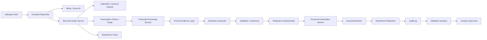
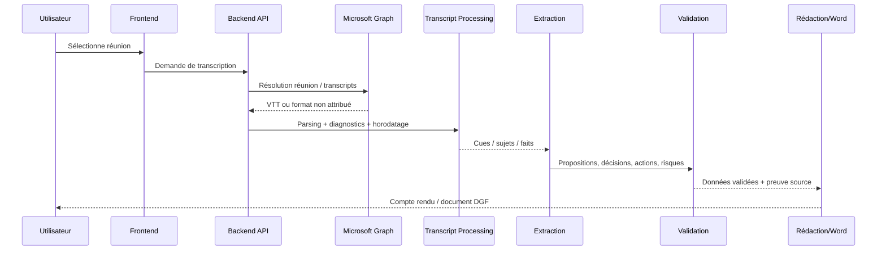
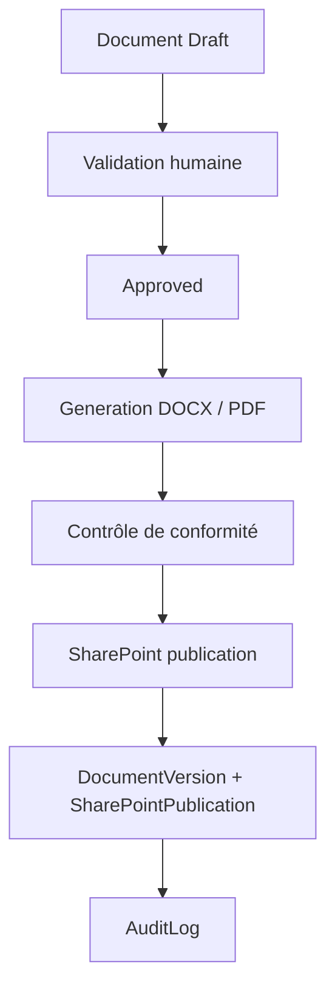
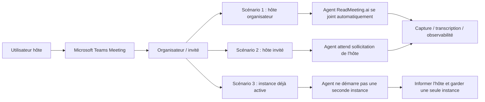

# 01 - Architecture cible

## 1. Objet

Ce document fixe l’architecture cible de ReadMeeting.ai pour la Direction Générale des Financements (DGF), en cohérence avec les constats d’audit et les validations terrain rapportées par le responsable du projet.

Important : la validation terrain confirmée concerne la récupération réelle des transcriptions Microsoft Teams dans les scénarios A et B. Les scripts automatisés présents dans le dépôt ne constituent pas nécessairement une reproduction de ces tests authentifiés et doivent être traités comme des outils de validation technique, non comme preuve d’acceptation métier.

## 2. Architecture existante

### 2.1. Technologies réellement présentes

Le dépôt contient une application web frontend en TypeScript/React et un socle backend .NET avec modèles métier et contrats d’intégration Microsoft 365.

Technologies observées :

- Frontend : React 19 + Vite + TypeScript
- Authentification : MSAL Browser / MSAL React
- Graph SDK : `@microsoft/microsoft-graph-client`
- Analyse transcriptes : logique TypeScript dédiée (`src/services/transcriptService.ts`)
- Backend C# : entités et interfaces dans `backend/src/ReadMeeting.Domain` et `backend/src/ReadMeeting.Application`
- Infrastructure IaC : Bicep dans `infra/main.bicep`
- CI/CD : GitHub Actions dans `.github/workflows/ci.yml`
- Documentation d’architecture : `docs/architecture.md`

### 2.2. Frontend réel

Le frontend est un client web moderne, avec :

- MSAL pour l’authentification Microsoft Entra ID
- gestion de calendrier, transcriptions et diagnostics
- composants de consultation de transcription et de dashboard
- écran de bibliographie de comptes rendus
- architecture de démonstration, plus que de production complète

Fichiers concernés :

- `src/App.tsx`
- `src/components/DashboardView.tsx`
- `src/components/TranscriptViewerModal.tsx`
- `src/components/ReportsLibraryView.tsx`
- `src/services/graphClient.ts`
- `src/services/transcriptService.ts`

### 2.3. Services Graph et capture de transcriptions

Le service Graph est utilisé pour :

- lire le calendrier
- détecter les réunions Teams
- résoudre le `onlineMeetingId`
- vérifier la présence de transcriptions
- récupérer la transcription native via l’API Microsoft Graph
- appliquer un fallback sur le format non attribué lorsque `SpeakerAttributionNotAllowed` est retourné

Le dépôt contient une logique de diagnostic et de traçabilité conforme à l’exigence métier de ne pas exposer les tokens et de conserver les événements du pipeline de transcription.

Fichiers concernés :

- `src/services/graphClient.ts`
- `src/services/transcriptService.ts`
- `src/types/transcript.ts`

### 2.4. État réel du backend

Le backend est présent comme un socle d’architecture métier, avec des entités et interfaces métier de la DGF :

- `Meeting`
- `MeetingReport`
- `ActionItem`
- contrat `IMicrosoftGraphService`

Le backend ne montre pas de réalisation complète du flux documentaire final, mais il existe bien comme base de conception et de séparation des responsabilités.

Fichiers concernés :

- `backend/src/ReadMeeting.Domain/Entities/Meeting.cs`
- `backend/src/ReadMeeting.Domain/Entities/MeetingReport.cs`
- `backend/src/ReadMeeting.Domain/Entities/ActionItem.cs`
- `backend/src/ReadMeeting.Application/Interfaces/IMicrosoftGraphService.cs`

### 2.5. Infrastructure et CI/CD

Le dépôt contient une cible Azure Bicep et une pipeline GitHub Actions.

Ce niveau confirme la volonté d’architecture Cloud et d’orchestration Azure, mais il n’implémente pas la totalité du flux documentaire final.

Fichiers concernés :

- `infra/main.bicep`
- `.github/workflows/ci.yml`
- `docs/architecture.md`

### 2.6. Composants documentaires ou simulés

Les éléments suivants sont présents mais ne doivent pas être pris comme preuve de fonctionnalité opérationnelle :

- l’interface de bibliothèque de rapports officiels dans `ReportsLibraryView.tsx` ;
- les structures de modèles de document dans `MeetingReport` et `DocumentDraftProposal` ;
- la mention d’Azure OpenAI / Copilot / SharePoint sans implémentation concrète et validée ;
- le fichier `README.md` qui mentionne Gemini sans code d’intégration réelle exploitable.

## 3. Comparaison des architectures

### 3.1. Options évaluées

#### Option A — React/Vite + backend .NET existant

Avantages :

- compatibilité forte avec le dépôt actuel ;
- séparation claire entre interface utilisateur et logique métier ;
- facilité de réutiliser les entités C# et le contrat Graph ;
- cohérence avec les modèles métiers déjà présents ;
- faible coût de migration sur le plan fonctionnel.

Limites :

- le frontend gère actuellement des tâches de transcription qui peuvent être déplacées plus proprement vers l’API ;
- l’architecture doit être explicitement codifiée pour éviter la logique métier dispersée.

#### Option B — React/Vite + backend TypeScript dédié

Avantages :

- forte cohérence technique avec le frontend ;
- développement rapide pour les services orchestrants et IA ;
- adapté à un environnement de traitement asynchrone et d’API REST.

Limites :

- duplication de logique métier par rapport au backend .NET existant ;
- plus d’effort de maintien si les deux stacks coexistent ;
- moins adapté à un système institutionnel qui demande un modèle de domaine rigoureux.

#### Option C — Next.js App Router + backend adapté

Avantages :

- productivité élevée sur l’UX ;
- architecture homogène pour les pages et l’API ;
- bon modèle si l’application devient une plateforme de travail collaboratif.

Limites :

- migration importante ;
- forte inertie sur un dépôt déjà structuré ;
- coût de refonte non justifié pour ce stade ;
- pas nécessaire à la récupération de transcriptions ni à la production de comptes rendus.

#### Option D — architecture hybride conservatrice (recommandée)

Description :

- Frontend React/Vite conservé ;
- API backend .NET conservée comme couche de métier ;
- services d’orchestration d’IA et de génération documentaire isolés dans un service d’application dédié ou Azure Function ;
- SharePoint et Graph exploités via endpoints spécifiques et identités distinctes ;
- persistance structurée via base de données métier.

### 3.2. Matrice comparative

| Critère | React/Vite + .NET | React/Vite + TS API | Next.js + backend | Hybride conservatrice |
|---|---|---|---|---|
| Compatibilité avec l’existant | Très élevée | Moyenne | Faible | Très élevée |
| Sécurité | Élevée | Élevée | Élevée | Élevée |
| Auth Microsoft | Très bonne | Bonne | Bonne | Très bonne |
| Traitement IA | Bonne si service isolé | Bonne | Bonne | Très bonne |
| Gestion fichiers | Bonne | Bonne | Bonne | Très bonne |
| SharePoint | Bonne via Graph | Bonne via Graph | Bonne via Graph | Très bonne |
| Persistance | Très bonne | Bonne | Bonne | Très bonne |
| Hébergement | Très bon | Bon | Bon | Très bon |
| Coût | Faible/modéré | Modéré | Élevé | Modéré |
| Maintenabilité | Très bonne | Moyenne | Moyenne | Très bonne |
| Évolutivité | Très bonne | Bonne | Bonne | Très bonne |
| Coût de migration | Faible | Moyen | Élevé | Faible |

### 3.3. Décision

La décision architecturale retenue est la suivante :

- conserver le frontend React/Vite actuellement présent ;
- conserver l’API .NET comme couche métier principale ;
- conserver la logique Microsoft Graph existante et validée ;
- isoler les services IA et génération documentaire dans un composant dédié ;
- ne pas engager de migration vers Next.js à ce stade ;
- ne pas réécrire la logique de transcription existante, mais l’intégrer dans un flux de service métier plus strict.

Justification :

- le dépôt contient déjà des éléments fonctionnels rassemblés et cohérents ;
- la transformation de transcription a été validée sur le terrain ;
- la cible DGF nécessite un système fiable et traçable, plus qu’un refactor complet ;
- cette option minimise le risque de régression.

## 4. Architecture logique cible

### 4.1. Vue d’ensemble

L’architecture cible tient compte des contraintes et garde la logique Graph déjà validée, tout en isolant le reste du flux documentaire.

### 4.2. Flux transcription → compte rendu

### 4.3. Flux de publication documentaire

### 4.4. Diagramme de participation Teams

## 5. Responsabilités des composants

### 5.1. Frontend

- affichage du dashboard de réunion ;
- navigation entre réunions / transcriptions ;
- analyse utilisateur ;
- affichage du statut Graph et du type de transcript (attribué ou non attribué) ;
- export des transcriptions.

### 5.2. Backend API

- gestion des objets métier ;
- orchestration des appels Graph ;
- authentification et vérification de consentement ;
- calcul de statut de transcription ;
- stockage et traçabilité des preuves.

### 5.3. Transcript Processing Service

- parse VTT ;
- parse format non attribué ;
- normalisation des timestamps ;
- stockage des cues ;
- association aux preuves et au contexte de réunion.

### 5.4. Extraction IA / métier

- extraction des sujets, faits, actions, décisions, risques, réserves ;
- classification du statut (proposé / confirmé / décidé / rejeté / reporté / à confirmer) ;
- association à des preuves et à des références sources.

### 5.5. Document generation service

- génération Word / PDF ;
- transformation du compte rendu structuré vers document institutionnel ;
- gestion des versions documentaires.

### 5.6. SharePoint publication layer

- publication sur la bibliothèque appropriée ;
- vérification du dépôt réel ;
- création des références de publication ;
- stockage de la version et de la métadonnée.

## 6. Contraintes à respecter

- ne pas modifier le comportement Graph déjà validé ;
- ne pas supposer une vraie participation Teams en direct sans validation Microsoft et DGF ;
- ne pas inventer un modèle officiel DGF non validé ;
- maintenir une traçabilité imprenable entre la transcription, les faits extraits et le document publié ;
- isoler les tenants et les données au niveau de la base et des politiques de sécurité.

## 7. Recommandations architecturales retenues

1. Conserver le frontend existant comme expérience utilisateur.
2. Consolider le backend .NET comme couche métier de référence.
3. Isoler l’intelligence documentaire et l’IA dans un service spécialisé.
4. Introduire un contrat strict de preuve pour chaque décision/action.
5. Ajouter un modèle de document officiel DGF sous contrôle métier.
6. Ne pas mettre en production un agent Teams sans validation de la DGF et des administrateurs Microsoft 365.
7. Rester compatible avec le test terrain de Graph déjà validé.

## 8. Conclusion

Cette architecture cible est un point d’équilibre réaliste entre la maturité déjà présente dans le dépôt et les exigences de fiabilité de la DGF. Elle n’ouvre pas de refonte générale, n’exige pas de migration brutale, et conserve les éléments validés sur le terrain tout en préparant l’écosystème complet de compte rendu institutionnel, validation humaine et publication documentaire.
