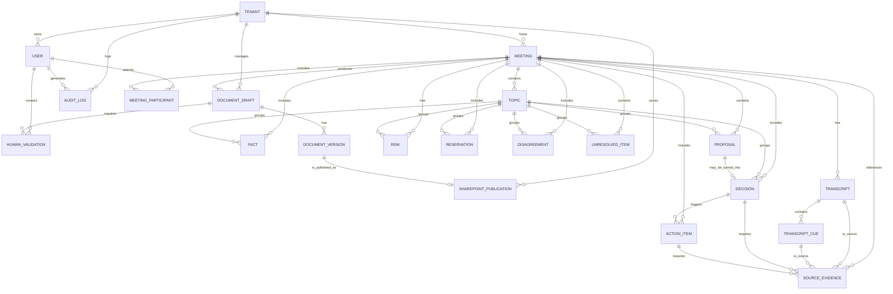

# 02 - Modèle de données métier

## 1. Objet

Ce document décrit le modèle de données métier attendu pour la production de comptes rendus institutionnels DGF à partir de réunions Microsoft Teams. Il est destiné à être directement exploitable lors de la conception de la base de données, sans supposer un niveau de maturité technique déjà atteint.

Le modèle est construit sur les exigences suivantes :

- les décideurs peuvent être non identifiés ;
- les responsables peuvent être inconnus ou non explicités ;
- les décisions et actions doivent être liées à des preuves sources ;
- les échéances absentes restent nulles ;
- les données sont isolées par tenant ;
- les historiques et traçabilités sont conservés.

## 2. Principes de conception

1. Toute information extraite doit être rattachée à une ou plusieurs preuves sources.
2. Une preuve source doit permettre de retrouver le passage original, son horodatage et son contexte de réunion.
3. Une décision, une action ou une réserve ne peut pas être considérée comme confirmée sans élément de preuve ou validation explicite.
4. Un responsable absent reste `NULL` : le système ne doit jamais inventer un nom.
5. Une échéance absente reste `NULL` : le système ne doit jamais créer de deadline non explicitée.
6. Les états sont explicites et séparés entre proposition, validation, décision, rejet et report.
7. Le multi-tenant est un principe de conception obligatoire.

## 3. Entités métier

### 3.1. Tenant

- Description : locataire de sécurité et de données. Représente le contexte DGF / entité / direction.
- Attributs :
  - `tenant_id` : UUID (PK)
  - `tenant_code` : varchar(50)
  - `tenant_name` : varchar(255)
  - `tenant_type` : enum (`DGF`, `Direction`, `Service`, `Project`, `External`)
  - `created_at` : datetime
  - `updated_at` : datetime
  - `status` : enum (`active`, `suspended`, `archived`)
- Relations : `User`, `Meeting`, `DocumentDraft`, `AuditLog`
- Contraintes :
  - un tenant doit être unique sur `tenant_code`
- Index recommandés : `tenant_code`, `status`
- Règles métier :
  - toutes les données d’un tenant sont isolées par clé de locataire ;
  - l’accès est contrôlé par la politique d’autorisation.

### 3.2. User

- Description : personne autorisée ou participant du système.
- Attributs :
  - `user_id` : UUID (PK)
  - `tenant_id` : UUID (FK vers `Tenant`)
  - `azure_object_id` : varchar(255)
  - `upn` : varchar(255)
  - `display_name` : varchar(255)
  - `mail` : varchar(255)
  - `department_code` : varchar(100)
  - `role` : enum (`admin`, `chair`, `rapporteur`, `participant`, `viewer`, `external`)
  - `is_active` : boolean
  - `created_at` : datetime
  - `updated_at` : datetime
- Relations : `MeetingParticipant`, `HumanValidation`, `AuditLog`
- Contraintes :
  - `upn` ou `mail` doit être renseigné
  - unicité logique sur `(tenant_id, upn)`
- Index recommandés : `(tenant_id, upn)`, `(tenant_id, mail)`, `azure_object_id`
- Règles métier :
  - un utilisateur externe ne doit pas être supposé interne ;
  - un responsable absent reste `NULL`.

### 3.3. Meeting

- Description : réunion de travail ou d’examen portant sur un sujet DGF.
- Attributs :
  - `meeting_id` : UUID (PK)
  - `tenant_id` : UUID (FK vers `Tenant`)
  - `microsoft_graph_id` : varchar(255)
  - `title` : varchar(500)
  - `description` : text nullable
  - `organizer_user_id` : UUID nullable (FK vers `User`)
  - `organizer_name` : varchar(255) nullable
  - `organizer_email` : varchar(255) nullable
  - `department_code` : varchar(100) nullable
  - `join_web_url` : varchar(1024) nullable
  - `start_time` : datetime
  - `end_time` : datetime nullable
  - `status` : enum (`scheduled`, `in_progress`, `completed`, `transcribing`, `transcribed`, `failed`)
  - `capture_method` : enum (`teams_native`, `meeting_bot`, `manual_import`)
  - `created_at` : datetime
  - `updated_at` : datetime
- Relations : `MeetingParticipant`, `Transcript`, `DocumentDraft`, `AuditLog`
- Contraintes :
  - `start_time` doit être renseigné
  - `microsoft_graph_id` est unique par tenant si présent
- Index recommandés : `(tenant_id, start_time)`, `microsoft_graph_id`, `status`
- Règles métier :
  - la présence de `join_web_url` ne donne pas automatiquement le statut de participation active ;
  - un organisateur externe ne doit pas être supposé interne à la DGF.

### 3.4. MeetingParticipant

- Description : participant d’une réunion, avec rôle et présence.
- Attributs :
  - `meeting_participant_id` : UUID (PK)
  - `meeting_id` : UUID (FK vers `Meeting`)
  - `user_id` : UUID nullable (FK vers `User`)
  - `external_identifier` : varchar(255) nullable
  - `display_name` : varchar(255)
  - `email` : varchar(255) nullable
  - `role` : enum (`organizer`, `coorganizer`, `attendee`, `guest`, `undetermined`)
  - `join_state` : enum (`joined`, `waiting`, `declined`, `not_joined`)
  - `is_active` : boolean
  - `created_at` : datetime
- Relations : `Meeting`, `User`, `SourceEvidence`
- Contraintes :
  - au moins un des champs `user_id`, `external_identifier`, `email` doit être renseigné
- Index recommandés : `(meeting_id, user_id)`, `(meeting_id, role)`, `(meeting_id, email)`
- Règles métier :
  - un participant peut être externe et ne pas avoir d’identité DGF ;
  - le rôle `undetermined` est admissible si la réunion est déroutée ou non explicitement connue.

### 3.5. Transcript

- Description : transcription récupérée d’une réunion Teams, avec ses métadonnées et son mode de récupération.
- Attributs :
  - `transcript_id` : UUID (PK)
  - `meeting_id` : UUID (FK vers `Meeting`)
  - `tenant_id` : UUID (FK vers `Tenant`)
  - `graph_transcript_id` : varchar(255) nullable
  - `content_format` : enum (`text_vtt`, `text_plain_unattributed`, `unknown`)
  - `language` : varchar(50) nullable
  - `retrieval_mode` : enum (`standard_vtt`, `fallback_unattributed`, `manual_import`)
  - `raw_content` : text nullable
  - `status` : enum (`pending`, `available`, `failed`, `rejected`, `parsed`)
  - `retrieved_at` : datetime
  - `parsed_at` : datetime nullable
  - `created_at` : datetime
- Relations : `TranscriptCue`, `SourceEvidence`, `DocumentDraft`, `AuditLog`
- Contraintes :
  - `meeting_id` doit être renseigné ;
  - `content_format` ne doit pas être `unknown` si le parsing est validé
- Index recommandés : `(meeting_id, status)`, `(tenant_id, retrieved_at)`, `graph_transcript_id`
- Règles métier :
  - si le format est non attribué, le système ne doit pas inventer un nom de locuteur ;
  - les timestamps doivent être conservés.

### 3.6. TranscriptCue

- Description : segment temporel d’une transcription.
- Attributs :
  - `cue_id` : UUID (PK)
  - `transcript_id` : UUID (FK vers `Transcript`)
  - `sequence_number` : integer
  - `speaker_name` : varchar(255) nullable
  - `speaker_label` : varchar(255) nullable
  - `start_time` : varchar(64)
  - `end_time` : varchar(64) nullable
  - `start_seconds` : decimal(10,3)
  - `end_seconds` : decimal(10,3) nullable
  - `text` : text
  - `confidence_score` : decimal(5,4) nullable
  - `created_at` : datetime
- Relations : `Transcript`, `SourceEvidence`, `Topic`, `Fact`
- Contraintes :
  - `text` ne doit pas être vide ;
  - `start_seconds` doit être non négatif
- Index recommandés : `(transcript_id, sequence_number)`, `(transcript_id, start_seconds)`
- Règles métier :
  - les séquences doivent être ordonnées chronologiquement ;
  - le nom de locuteur peut être vide si la transcription est non attribuée.

### 3.7. Topic

- Description : sujet de discussion principal ou secondaire de la réunion.
- Attributs :
  - `topic_id` : UUID (PK)
  - `meeting_id` : UUID (FK vers `Meeting`)
  - `title` : varchar(255)
  - `summary` : text nullable
  - `status` : enum (`discussed`, `confirmed`, `closed`)
  - `created_at` : datetime
- Relations : `Fact`, `Decision`, `Proposal`, `Risk`, `Reservation`, `UnresolvedItem`
- Index recommandés : `(meeting_id, title)`, `status`
- Règles métier :
  - un sujet peut couvrir plusieurs faits ou décisions.

### 3.8. Fact

- Description : fait rapporté dans la réunion, avec niveau d’objectivité.
- Attributs :
  - `fact_id` : UUID (PK)
  - `meeting_id` : UUID (FK vers `Meeting`)
  - `topic_id` : UUID nullable (FK vers `Topic`)
  - `text` : text
  - `fact_type` : enum (`context`, `status_update`, `constraint`, `risk`, `budget`, `deadline`, `other`)
  - `source_evidence_id` : UUID nullable (FK vers `SourceEvidence`)
  - `confidence` : decimal(5,4) nullable
  - `status` : enum (`observed`, `validated`, `contradicted`, `rejected`)
  - `created_at` : datetime
- Relations : `Topic`, `SourceEvidence`, `Decision`, `ActionItem`
- Contraintes :
  - `text` non vide
- Index recommandés : `(meeting_id, fact_type)`, `(source_evidence_id)`
- Règles métier :
  - les faits non confirmés doivent rester au statut `observed` ou `contradicted`.

### 3.9. Proposal

- Description : proposition formulée au cours de la réunion.
- Attributs :
  - `proposal_id` : UUID (PK)
  - `meeting_id` : UUID (FK vers `Meeting`)
  - `topic_id` : UUID nullable (FK vers `Topic`)
  - `text` : text
  - `proposed_by_user_id` : UUID nullable (FK vers `User`)
  - `proposed_by_name` : varchar(255) nullable
  - `status` : enum (`proposed`, `confirmed`, `decided`, `rejected`, `reported`, `to_confirm`)
  - `decision_id` : UUID nullable (FK vers `Decision`)
  - `created_at` : datetime
  - `updated_at` : datetime
- Relations : `Meeting`, `Topic`, `Decision`, `SourceEvidence`
- Contraintes :
  - `text` non vide
- Index recommandés : `(meeting_id, status)`, `(proposed_by_user_id)`
- Règles métier :
  - une proposition ne devient pas automatiquement une décision ;
  - un statut `decided` exige validation explicite.

### 3.10. Decision

- Description : décision prise ou confirmée lors de la réunion.
- Attributs :
  - `decision_id` : UUID (PK)
  - `meeting_id` : UUID (FK vers `Meeting`)
  - `topic_id` : UUID nullable (FK vers `Topic`)
  - `text` : text
  - `status` : enum (`proposed`, `confirmed`, `decided`, `rejected`, `reported`, `to_confirm`)
  - `decision_type` : enum (`consensus`, `vote`, `chair_decision`, `external_validation`)
  - `approved_by_user_id` : UUID nullable (FK vers `User`)
  - `approved_by_name` : varchar(255) nullable
  - `created_at` : datetime
  - `updated_at` : datetime
- Relations : `Proposal`, `ActionItem`, `DocumentDraft`, `SourceEvidence`
- Contraintes :
  - un responsable manquant doit rester `NULL`
- Index recommandés : `(meeting_id, status)`, `(approved_by_user_id)`
- Règles métier :
  - une décision doit être rattachée à au moins une preuve source ;
  - un responsable absent ne doit pas être substitué.

### 3.11. ActionItem

- Description : action de suivi attribuée à un responsable.
- Attributs :
  - `action_item_id` : UUID (PK)
  - `meeting_id` : UUID (FK vers `Meeting`)
  - `decision_id` : UUID nullable (FK vers `Decision`)
  - `title` : varchar(255)
  - `description` : text
  - `assignee_user_id` : UUID nullable (FK vers `User`)
  - `assignee_name` : varchar(255) nullable
  - `assignee_email` : varchar(255) nullable
  - `deadline` : date nullable
  - `priority` : enum (`low`, `medium`, `high`, `urgent`)
  - `status` : enum (`proposed`, `confirmed`, `in_progress`, `done`, `rejected`, `deferred`)
  - `created_at` : datetime
  - `updated_at` : datetime
- Relations : `Decision`, `User`, `SourceEvidence`
- Contraintes :
  - `title` non vide
  - `deadline` null si absence de date explicite
- Index recommandés : `(meeting_id, status)`, `(assignee_user_id, deadline)`
- Règles métier :
  - absence de responsable = tolérée, jamais inventée ;
  - absence de deadline = tolérée, jamais calculée à partir d’une hypothèse.

### 3.12. Risk

- Description : risque ou difficulté signalé lors de la réunion.
- Attributs :
  - `risk_id` : UUID (PK)
  - `meeting_id` : UUID (FK vers `Meeting`)
  - `topic_id` : UUID nullable (FK vers `Topic`)
  - `title` : varchar(255)
  - `description` : text
  - `severity` : enum (`low`, `medium`, `high`, `critical`)
  - `status` : enum (`identified`, `tracked`, `mitigated`, `accepted`, `resolved`)
  - `created_at` : datetime
- Relations : `Topic`, `SourceEvidence`
- Index recommandés : `(meeting_id, severity)`, `status`
- Règles métier :
  - le risque doit être rattaché à un passage source ou à une preuve explicite.

### 3.13. Reservation

- Description : réserve, condition ou précaution exprimée par un participant.
- Attributs :
  - `reservation_id` : UUID (PK)
  - `meeting_id` : UUID (FK vers `Meeting`)
  - `topic_id` : UUID nullable (FK vers `Topic`)
  - `text` : text
  - `expressed_by_user_id` : UUID nullable (FK vers `User`)
  - `expressed_by_name` : varchar(255) nullable
  - `status` : enum (`stated`, `accepted`, `rejected`, `deferred`)
  - `created_at` : datetime
- Relations : `Topic`, `SourceEvidence`
- Index recommandés : `(meeting_id, status)`, `(expressed_by_user_id)`
- Règles métier :
  - les réserves ne doivent pas être transformées en décisions.

### 3.14. Disagreement

- Description : désaccord ou opposition explicite dans la discussion.
- Attributs :
  - `disagreement_id` : UUID (PK)
  - `meeting_id` : UUID (FK vers `Meeting`)
  - `topic_id` : UUID nullable (FK vers `Topic`)
  - `text` : text
  - `expressed_by_user_id` : UUID nullable (FK vers `User`)
  - `expressed_by_name` : varchar(255) nullable
  - `status` : enum (`stated`, `acknowledged`, `resolved`, `persisting`)
  - `created_at` : datetime
- Relations : `Topic`, `SourceEvidence`
- Index recommandés : `(meeting_id, status)`, `(expressed_by_user_id)`
- Règles métier :
  - un désaccord exprimé ne doit pas être interprété comme décision validée.

### 3.15. UnresolvedItem

- Description : point restant à arbitrer ou non tranché.
- Attributs :
  - `unresolved_item_id` : UUID (PK)
  - `meeting_id` : UUID (FK vers `Meeting`)
  - `topic_id` : UUID nullable (FK vers `Topic`)
  - `title` : varchar(255)
  - `description` : text
  - `reason` : text nullable
  - `status` : enum (`open`, `pending_validation`, `resolved`, `rejected`)
  - `created_at` : datetime
- Relations : `Topic`, `SourceEvidence`
- Index recommandés : `(meeting_id, status)`, `title`
- Règles métier :
  - le système doit distinguer clairement une information non communiquée, une réserve et un point restant à arbitrer.

### 3.16. SourceEvidence

- Description : preuve source associée à un fait, une décision ou une action.
- Attributs :
  - `source_evidence_id` : UUID (PK)
  - `meeting_id` : UUID (FK vers `Meeting`)
  - `transcript_id` : UUID nullable (FK vers `Transcript`)
  - `cue_id` : UUID nullable (FK vers `TranscriptCue`)
  - `participant_user_id` : UUID nullable (FK vers `User`)
  - `participant_name` : varchar(255) nullable
  - `speaker_label` : varchar(255) nullable
  - `source_type` : enum (`transcript_cue`, `meeting_metadata`, `manual_note`, `external_document`)
  - `source_text` : text
  - `start_time` : varchar(64) nullable
  - `end_time` : varchar(64) nullable
  - `reference_uri` : varchar(2048) nullable
  - `created_at` : datetime
- Relations : `Transcript`, `TranscriptCue`, `Meeting`, `User`, `Fact`, `Decision`, `ActionItem`, `Risk`, `Proposal`
- Contraintes :
  - `source_text` non vide
  - `start_time` n’est pas obligatoire si la preuve provient d’un autre support
- Index recommandés : `(meeting_id, source_type)`, `(transcript_id, cue_id)`, `(participant_user_id)`
- Règles métier :
  - chaque preuve doit permettre la localisation du passage original ;
  - la présence d’un horodatage ou d’une référence source est obligatoire pour les éléments de décision/action.

### 3.17. DocumentDraft

- Description : brouillon de compte rendu généré à partir de la réunion et des éléments structurés.
- Attributs :
  - `document_draft_id` : UUID (PK)
  - `meeting_id` : UUID (FK vers `Meeting`)
  - `tenant_id` : UUID (FK vers `Tenant`)
  - `title` : varchar(255)
  - `status` : enum (`draft`, `review`, `approved`, `rejected`, `published`)
  - `executive_summary` : text nullable
  - `department_code` : varchar(100) nullable
  - `chairperson_name` : varchar(255) nullable
  - `rapporteur_name` : varchar(255) nullable
  - `generated_at` : datetime
  - `updated_at` : datetime
- Relations : `Meeting`, `HumanValidation`, `DocumentVersion`, `SharePointPublication`
- Index recommandés : `(meeting_id, status)`, `(tenant_id, generated_at)`
- Règles métier :
  - un document en publication doit rester lié à sa version finale.

### 3.18. DocumentVersion

- Description : version d’un document généré ou approuvé.
- Attributs :
  - `document_version_id` : UUID (PK)
  - `document_draft_id` : UUID (FK vers `DocumentDraft`)
  - `version_number` : integer
  - `file_name` : varchar(255)
  - `mime_type` : varchar(100)
  - `storage_uri` : varchar(2048) nullable
  - `hash_sha256` : varchar(128) nullable
  - `generated_by` : varchar(255) nullable
  - `generated_at` : datetime
  - `status` : enum (`draft`, `ready`, `approved`, `published`, `rejected`)
- Relations : `DocumentDraft`, `SharePointPublication`
- Index recommandés : `(document_draft_id, version_number)`
- Règles métier :
  - chaque document a une version finale de référence ;
  - les documents rejetés doivent rester conservés dans l’historique sans être publiés.

### 3.19. HumanValidation

- Description : validation humaine d’un document ou d’éléments extraits.
- Attributs :
  - `human_validation_id` : UUID (PK)
  - `document_draft_id` : UUID nullable (FK vers `DocumentDraft`)
  - `reviewer_user_id` : UUID nullable (FK vers `User`)
  - `reviewer_name` : varchar(255) nullable
  - `status` : enum (`draft`, `under_review`, `changes_requested`, `approved`, `rejected`)
  - `comments` : text nullable
  - `validated_at` : datetime nullable
  - `signature_ref` : varchar(255) nullable
- Relations : `DocumentDraft`, `User`
- Index recommandés : `(document_draft_id, status)`, `(reviewer_user_id)`
- Règles métier :
  - l’approbation humaine est obligatoire avant publication ;
  - un rejet de document conserve l’historique sans publication.

### 3.20. SharePointPublication

- Description : publication effective d’un document dans SharePoint.
- Attributs :
  - `sharepoint_publication_id` : UUID (PK)
  - `document_version_id` : UUID (FK vers `DocumentVersion`)
  - `tenant_id` : UUID (FK vers `Tenant`)
  - `site_id` : varchar(255) nullable
  - `drive_id` : varchar(255) nullable
  - `folder_path` : varchar(2048) nullable
  - `file_id` : varchar(255) nullable
  - `web_url` : varchar(2048) nullable
  - `status` : enum (`pending`, `published`, `failed`, `duplicate`, `error`)
  - `published_at` : datetime nullable
  - `error_code` : varchar(255) nullable
  - `error_message` : text nullable
- Relations : `DocumentVersion`, `Tenant`
- Index recommandés : `(document_version_id, status)`, `(tenant_id, site_id)`
- Règles métier :
  - aucune publication sans validation humaine ;
  - un doublon doit être signalé et ne pas écraser le fichier précédent.

### 3.21. AuditLog

- Description : journal d’audit de toutes les opérations de fond.
- Attributs :
  - `audit_log_id` : UUID (PK)
  - `tenant_id` : UUID nullable (FK vers `Tenant`)
  - `user_id` : UUID nullable (FK vers `User`)
  - `entity_type` : varchar(100)
  - `entity_id` : UUID nullable
  - `action` : varchar(100)
  - `details_json` : jsonb/text
  - `created_at` : datetime
  - `source_ip` : varchar(128) nullable
  - `request_id` : varchar(255) nullable
- Relations : `Tenant`, `User`
- Index recommandés : `(tenant_id, created_at)`, `(entity_type, entity_id)`, `(user_id, created_at)`
- Règles métier :
  - tous les événements clés doivent être tracés ;
  - les jetons d’accès ne doivent jamais être enregistrés ;
  - les contenus de transcriptions ne doivent pas être loggés en clair dans les journaux techniques.

## 4. Diagramme entité-association



## 5. Schéma relationnel (exemple logique)

```text
Tenant(
  tenant_id PK,
  tenant_code, tenant_name, tenant_type, status, created_at, updated_at
)

User(
  user_id PK, tenant_id FK, azure_object_id, upn, display_name, mail,
  department_code, role, is_active, created_at, updated_at
)

Meeting(
  meeting_id PK, tenant_id FK, microsoft_graph_id, title, description,
  organizer_user_id FK, organizer_name, organizer_email, department_code,
  join_web_url, start_time, end_time, status, capture_method, created_at, updated_at
)

MeetingParticipant(
  meeting_participant_id PK, meeting_id FK, user_id FK nullable,
  external_identifier, display_name, email, role, join_state, is_active, created_at
)

Transcript(
  transcript_id PK, meeting_id FK, tenant_id FK, graph_transcript_id,
  content_format, language, retrieval_mode, raw_content, status,
  retrieved_at, parsed_at, created_at
)

TranscriptCue(
  cue_id PK, transcript_id FK, sequence_number, speaker_name, speaker_label,
  start_time, end_time, start_seconds, end_seconds, text, confidence_score, created_at
)

Topic(
  topic_id PK, meeting_id FK, title, summary, status, created_at
)

Fact(
  fact_id PK, meeting_id FK, topic_id FK nullable, text, fact_type,
  source_evidence_id FK nullable, confidence, status, created_at
)

Proposal(
  proposal_id PK, meeting_id FK, topic_id FK nullable, text,
  proposed_by_user_id FK nullable, proposed_by_name, status,
  decision_id FK nullable, created_at, updated_at
)

Decision(
  decision_id PK, meeting_id FK, topic_id FK nullable, text, status,
  decision_type, approved_by_user_id FK nullable, approved_by_name, created_at, updated_at
)

ActionItem(
  action_item_id PK, meeting_id FK, decision_id FK nullable, title,
  description, assignee_user_id FK nullable, assignee_name, assignee_email,
  deadline, priority, status, created_at, updated_at
)

Risk(
  risk_id PK, meeting_id FK, topic_id FK nullable, title, description,
  severity, status, created_at
)

Reservation(
  reservation_id PK, meeting_id FK, topic_id FK nullable, text,
  expressed_by_user_id FK nullable, expressed_by_name, status, created_at
)

Disagreement(
  disagreement_id PK, meeting_id FK, topic_id FK nullable, text,
  expressed_by_user_id FK nullable, expressed_by_name, status, created_at
)

UnresolvedItem(
  unresolved_item_id PK, meeting_id FK, topic_id FK nullable, title,
  description, reason, status, created_at
)

SourceEvidence(
  source_evidence_id PK, meeting_id FK, transcript_id FK nullable,
  cue_id FK nullable, participant_user_id FK nullable, participant_name,
  speaker_label, source_type, source_text, start_time, end_time,
  reference_uri, created_at
)

DocumentDraft(
  document_draft_id PK, meeting_id FK, tenant_id FK, title, status,
  executive_summary, department_code, chairperson_name, rapporteur_name,
  generated_at, updated_at
)

DocumentVersion(
  document_version_id PK, document_draft_id FK, version_number, file_name,
  mime_type, storage_uri, hash_sha256, generated_by, generated_at, status
)

HumanValidation(
  human_validation_id PK, document_draft_id FK nullable, reviewer_user_id FK nullable,
  reviewer_name, status, comments, validated_at, signature_ref
)

SharePointPublication(
  sharepoint_publication_id PK, document_version_id FK, tenant_id FK,
  site_id, drive_id, folder_path, file_id, web_url, status, published_at,
  error_code, error_message
)

AuditLog(
  audit_log_id PK, tenant_id FK nullable, user_id FK nullable,
  entity_type, entity_id, action, details_json, created_at, source_ip, request_id
)
```

## 6. Dictionnaire de données

| Champ | Type | Description | Règle |
|---|---|---|---|
| `status` | enum | Cycle de vie | Un statut doit être explicite et stable |
| `deadline` | date nullable | Date d’échéance | Ne pas inventer une date absente |
| `assignee_name` | varchar nullable | Responsable déclaré | Peut rester null si absent |
| `speaker_name` | varchar nullable | Intervenant de la transcription | Peut rester null si non attribué |
| `content_format` | enum | Format de transcription | Doit distinguer VTT et non attribué |
| `version_number` | integer | Numéro de version | Doit être strictement croissant |
| `hash_sha256` | varchar | Empreinte du document | Requis pour audit et contrôle |
| `details_json` | json | Détails d’événement | Ne doit pas contenir jetons ni contenus sensibles |

## 7. Règles d’intégrité

1. Une décision ou une action doit avoir au moins une source d’évidence.
2. Un `Decision` ne peut être `decided` sans une validation explicite ou sans preuve source.
3. Un `ActionItem` ne peut avoir de `deadline` que si celle-ci est explicitement déclarée.
4. Une `Proposal` ne peut devenir `decided` sans transition claire vers `Decision`.
5. Une transcription non attribuée doit conserver une valeur de `speaker_name` nulle ou un label standard explicitement non attribué, sans inventer un nom.
6. Un document publié doit avoir une `DocumentVersion` validée par `HumanValidation`.
7. Le `tenant_id` est obligatoire pour toute donnée d’exploitation de la réunion.
8. Les logs ne doivent pas stocker les tokens d’accès ou les transcriptions complètes en clair.

## 8. Règles de sécurité et d’isolation

- Isolation des tenants par `tenant_id` sur toutes les tables de données d’exploitation.
- Vérification des accès à l’échelle du rôle utilisateur et du tenant.
- Règle de séparation de données : un utilisateur ne peut consulter que les données de son tenant.
- Les journaux ne doivent pas exposer les accès ou transcriptions complètes.
- Les documents publiés doivent être reliés à leur version et à leur publication finale.
- Les documents rejetés doivent être conservés mais non diffusés.
- Les opérations sensibles doivent produire des entrées dans `AuditLog` avec `request_id` ou équivalent.

## 9. Statuts métier requis

Pour les décisions et actions, les statuts doivent permettre de distinguer explicitement :

- `proposed`
- `confirmed`
- `decided`
- `rejected`
- `reported`
- `to_confirm`

Pour les documents et validations :

- `draft`
- `under_review`
- `changes_requested`
- `approved`
- `rejected`
- `published`

Pour les publications SharePoint :

- `pending`
- `published`
- `failed`
- `duplicate`
- `error`

## 10. Conclusion

Le modèle de données ci-dessus est un socle de conception conforme au besoin institutionnel et au niveau de maturité actuel du projet. Il n’exige pas une refonte générale de l’architecture existante, mais il impose une discipline explicite de preuve, de traçabilité et d’isolation tenant. Le point central est que chaque décision ou action doit être ancrée dans une source de vérité, avec horodatage et identification claire du contexte de réunion.
